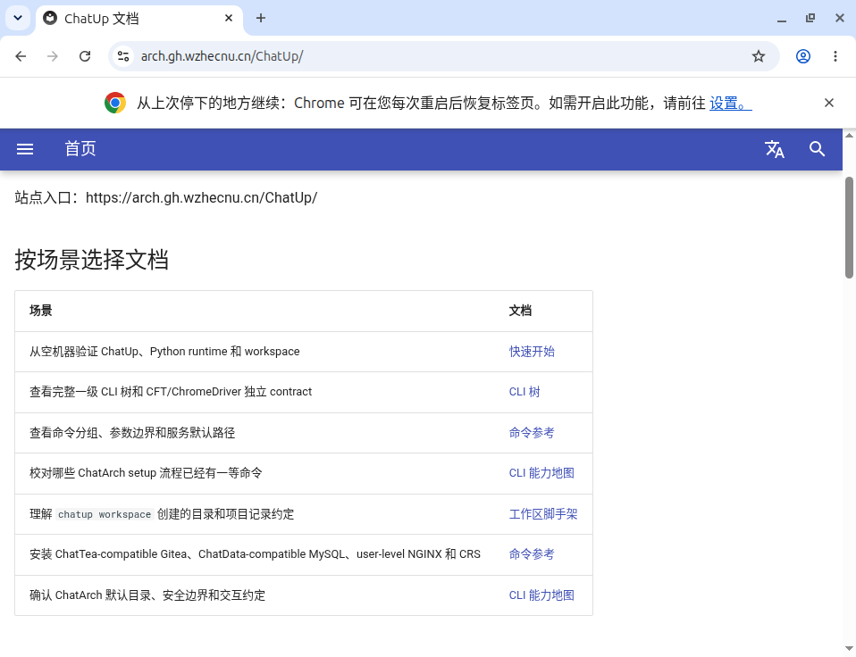
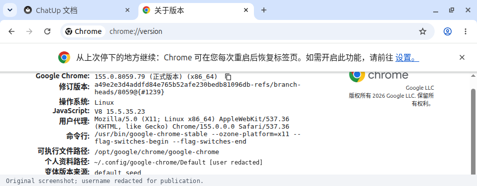
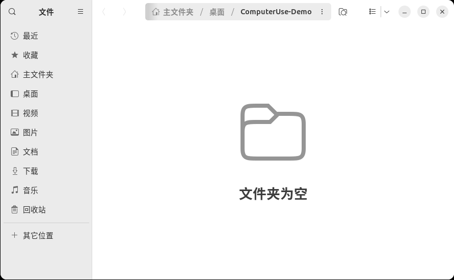

“Agent 能操作电脑”这句话，很容易把几件不同的事混在一起：它能执行 SSH 命令，能控制一扇浏览器窗口，还是能像人一样打开桌面应用、点菜单、创建文件？如果浏览器能打开，它操作的又是不是我平时登录过的那一份？

这次在一套**从 U 盘启动的 Ubuntu** 上，把这些问题分开做了真实实践：先操作终端和应用菜单，再进入原来的 GNOME 桌面使用正式 Chrome，最后通过桌面右键菜单新建一个文件夹，并用鼠标双击打开。

结果是：**本轮验证的普通 Chrome、桌面菜单和文件管理器能够操作，但 GUI 可控、浏览器协议接入、用户登录态并不是同一种能力。** 这篇文章记录实际做到的部分，也保留没有做到和需要额外授权的部分。

<!-- truncate -->

## 先看真正打开的浏览器

[](./assets/chrome-docs.png)

*这是原 GNOME 桌面上的真实截图。地址栏由原生 GUI 输入，网页已经显示 ChatUp 官方文档内容，不是只启动一个空窗口，也不是把 HTTP 请求结果画成浏览器。点击图片可以查看原图。*

这里使用的是系统安装的 **Google Chrome 155.0.8059.79 正式版**。这轮开始时，系统默认浏览器还是 Firefox，Agent 受管目录里另有一份 Chrome for Testing；没有把后者拿来冒充日常 Chrome。

正式 Chrome 的 Linux 安装功能已经在 ChatUp 中存在，不需要再造安装脚本。当前采用公开的 ChatUp `0.2.23`，实际运行的是：

```bash
# 先看安装计划，不下载、不执行安装
chatup chrome --dry-run --sudo --yes

# 确认后安装正式桌面 Chrome
chatup chrome --sudo --yes

# 以当前普通用户启动日常浏览器
google-chrome-stable
```

本机实际走的是 Ubuntu x86_64 的官方 DEB 分支，包管理器只新增了 Chrome，没有升级或移除其他软件。RPM、Windows、macOS 和其他架构不属于这轮的运行实测范围。

Chrome for Testing 本身是正常的测试工具，适合版本固定、CI 和隔离实验。本轮选择正式 Chrome，并保留这次新装后的默认 profile，是为了让后续人工使用与 GUI 操作沿用这一份浏览器数据；这不表示已迁移旧账号，也不代表网站不会识别自动化。网络、行为、账号状态和站点风控仍然各自生效。

## 看着不像原桌面，不等于另一台虚拟机

最初的终端和软件菜单演示是在独立的 Xfce 自动化桌面中完成的；后来的 Chrome 和文件夹实践则切换到了原来的 GNOME 图形会话。

```text
同一套正在运行的 Ubuntu，同一个用户
├─ 原 GNOME 桌面
│  ├─ 正式 Google Chrome
│  └─ 用户的日常默认 profile
└─ Agent 专用 Xfce 图形会话
   └─ 可使用单独的窗口、浏览器安装和 profile
```

独立的是图形工作区，不是独立操作系统。两边仍然共享这个用户能够访问的磁盘文件和系统资源。**专用桌面可以减少窗口相互干扰，却不是文件权限沙箱。**

还要把三个层次拆开：

- **桌面会话**决定窗口在哪里出现。
- **浏览器程序**决定运行哪份 Chrome，可执行文件可能来自系统包，也可能来自受管工具目录。
- **profile**决定浏览器使用哪份 Cookie、扩展、站点存储和设置。

同一个 Linux 用户，并不自动等于同一份 profile；同一个 Chrome 程序，也能打开不同 profile。背景图片相同或不同，都不能证明登录数据是否共享。

## 默认 profile 这一步，实际核对了什么

[](./assets/chrome-profile.png)

*这张图来自同一个 Chrome 窗口的版本页面。公开图片只裁切了无关区域，并把用户名替换为通用路径表示；版本、程序位置和启动参数没有改写。*

实际版本页显示系统 Chrome 的普通启动入口，个人资料路径落在用户的：

```text
~/.config/google-chrome/Default
```

启动时没有另加测试用的 `--user-data-dir`、无头模式、自动化标记或远程调试端口。默认浏览器已经按使用者的要求设为 Chrome，使用统计和崩溃报告上传最终关闭，并回读了落盘状态。

这是**新装正式 Chrome 后建立的日常默认 profile**，不是从未启动的另一套系统恢复了旧账号，也没有从测试 profile 复制 Cookie。普通 Chrome 窗口一直保留，后续使用者可以在这个窗口手动登录网站，再让 Agent 操作同一份数据。

不过，接续条件和认证成功仍是两件事。这轮跳过了 Google 账号同步登录，也没有登录任何具体网站，因此不能把它写成“所有站点的登录态共享都已验证”。Google 账号同步、某个网站的会话、验证码和会话过期，也不能混为一谈。

## 浏览器有两条控制路线

这次最容易误解的地方，是把“能点 Chrome”当成“浏览器专用工具也已经接入”。

| 路线 | 实际面对的对象 | 本轮结果 |
|---|---|---|
| 原生 GUI | 窗口、地址栏、按钮、辅助功能树、屏幕像素 | 已操作日常 Chrome，完成地址输入、设置和公共网页显示 |
| 浏览器专用工具 | 浏览器目标、标签页、DOM/语义引用、DevTools 连接 | 对同一个真实窗口只读探测，返回 `browser_consent_required` |
| SSH / 文件接口 | 程序版本、配置状态、目录和所有权 | 只用来交叉验证，不代替 GUI 输入或创建目录 |

原生 GUI 路线也能通过辅助功能接口读到网页标题、链接和可见控件，但它不等于已经获得完整的 DOM/CDP 通道。

本轮的浏览器专用工具在继续检查日常 profile 的 DevTools 入口之前，要求明确的 existing-profile 授权。这是独立门禁，不是网页已经坏了，也不是 Linux 上不能控制 Chrome。测试没有为了拿到一个“成功”而悄悄改权限模式、另起隔离 profile、重启用户浏览器或加入调试参数。

所以，当前能肯定的是**原生 GUI 控制已经可用**；不能把浏览器专用工具的存在，写成它已经绑定了当前日常浏览器。若之后要走这条路线，应按执行器的正式授权与绑定流程单独验收。

## 不只浏览器：用鼠标在桌面创建一个真实目录

第二组实践不走浏览器，也不走 shell 创建文件。

实际动作是：

1. 点击 Chrome 的最小化按钮，露出原 GNOME 桌面。
2. 在桌面空白处鼠标右键，选择“新建文件夹”。
3. 在界面名称字段中填写 `ComputerUse-Demo`，回读确认名称，再用鼠标点击“确定”。
4. 对出现的桌面图标执行原生鼠标双击。
5. 等到文件管理器真实窗口出现，再核对位置和内容。

[](./assets/desktop-folder-created.png)

*裁切后的原桌面截图，保留了新建目录图标。名称文字通过原生辅助功能字段赋值；创建菜单、确认和打开由 GUI 操作完成，没有调用 `mkdir` 或文件写入接口。*

[](./assets/files-folder-opened.png)

*鼠标双击后，系统文件管理器 Nautilus 打开了这个真实目录。面包屑是“主文件夹 / 桌面 / ComputerUse-Demo”，内容区显示“文件夹为空”。*

最后才做只读的文件系统核对：目录确实存在，所有者是当前普通用户，内容为空。**“界面里出现了图标”和“真实产物存在”两层证据都具备，才算这次创建完成。** 目录和应用窗口都保留给使用者继续检查。

这证明了普通原生应用的菜单、字段和窗口可以参与同一工作流，不是只能在网页里点按钮。但它不证明复杂绘图软件、游戏、任意自绘控件或每一种文件管理器都同样可靠。

## 几次失败，反而把边界讲清楚了

### 后台请求发出，不等于输入已经生效

一些控件可以通过原生辅助功能动作在后台操作，另一些键鼠路径会明确返回 `background_unavailable`，或者只给出 `unverifiable`。实际处理是先重新观察，再根据拒绝信息或已确认的无效果升级到前台输入。

前台路径会短暂激活目标窗口，所以不能宣传成“所有动作都不影响人的焦点”。也不能在输入已经成功后因为返回值不够漂亮，就再点一次，把开关反向切回去。

### 首次弹窗、主窗口和网页的语义信息不一样

Chrome 最早的首次启动窗口只回退到窗口元数据，无法据此判断复选框状态。后来 Chrome 主窗口、设置页和 Nautilus 则提供了可用的原生语义树。

“这一次没有识别到控件”不等于“整个桌面没有辅助功能支持”；反过来，一个窗口有标题，也不等于其中每个状态都可读。

### 字符串也需要验收

原桌面当时开着 CapsLock，原生模拟键入曾出现大小写反转。实践期间临时关闭，结束后恢复了原状态。

命名字段还有另一个问题：`type_text` 的原生插入路径会追加旧内容，不能因为视觉上似乎选中了文本，就假定它会替换。确认之前回读发现名称不对，改用界面的 `set_value` 精确替换，最后才点击确定。

这类细节决定了动作能否真正完成。工具返回“输入了若干字符”，不是文件名或地址已经正确的证明。

### 截图也需要有界生命周期

一次首次对话框切换后，旧窗口的截图回退进程卡住，连其他窗口查询也受到了影响。取消本任务拥有的截图子进程后恢复，没有重启 Chrome、Xorg 或 GNOME。后续执行器改为有界的用户瞬态单元管理，实践结束后正常退出。

因此，截图不能只当作无条件可靠的旁路：模态窗口关闭后应重新确认窗口标识，执行器和截图 worker 要有可追踪的所有权、时限与清理路径。正常清理自己的短时进程，也不应变成每一步都打断使用者的审批。

## 这轮可以交付的能力范围

| 场景 | 验证结论 |
|---|---|
| GUI 终端打开、输入 `pwd`、退出 | 已在专用自动化桌面完成，画面输出为 `/` |
| 应用菜单浏览 | 已展开分类并做键盘首尾浏览；短菜单一屏显示，没有冒充滚轮长列表验收 |
| 原 GNOME 的日常 Chrome | 正式程序、公共网页、默认 profile 和设置已核对 |
| 桌面鼠标创建与打开目录 | 已通过右键菜单、界面命名和双击打开，真实目录交叉验证 |
| 浏览器专用 DOM/CDP 通道 | 当前日常 profile 的授权门禁已实测，尚未接入 |
| 网站账号、验证码、会话续接 | 没有实际登录，不列为已通过 |
| Wayland、其他操作系统、复杂自绘应用 | 本轮没有测试 |

这些截图都来自 Hermes 路径：早期终端是远端 Hermes Agent 的原生工具调用；后续菜单、Chrome 和桌面目录是主 Hermes 通过目标机的 Cua 原生 MCP 操作。本轮没有把 Codex 的截图混进来，也没有把命令行输出伪装成桌面结果。图形执行器使用的 Cua Driver 版本为 `0.21.0`，结论只覆盖这套实际环境和以上案例。

最终留下的是一个能接着用的普通 Chrome、一个可检查的桌面目录，以及“哪些已经证实、哪些仍需授权或实测”的明确分界。**Computer Use 的价值不在于一句“全都能点”，而在于让每一步的观察、动作和结果对得上。**

## 相关入口

- [ChatUp 文档](https://arch.gh.wzhecnu.cn/ChatUp/) 与 [ChatUp 源码](https://github.com/ChatArch/ChatUp)
- [Hermes Agent 官方文档](https://hermes-agent.nousresearch.com/docs)
- [Cua 项目与执行器](https://github.com/trycua/cua)

本文图片均来自实际 GUI 截图；公开版只做裁切和必要的用户名脱敏，没有改写应用界面或合成操作结果。

本篇的内容状态为**待精选**，表示尚未进入人工推荐区，不是对部署状态或质量的自动背书。`unlisted` 只影响发现入口，不是访问控制；不能用它保护私有正文或图片。
